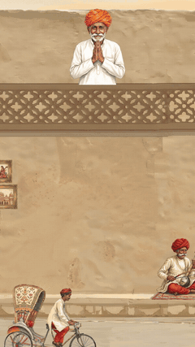
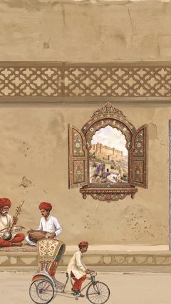
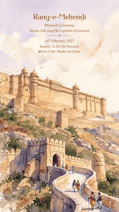
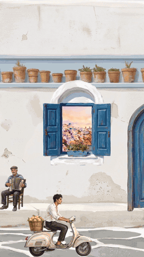
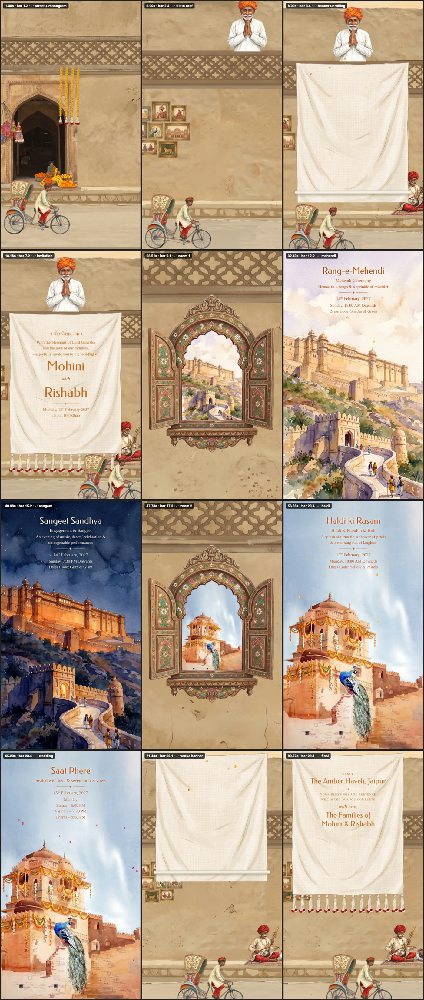
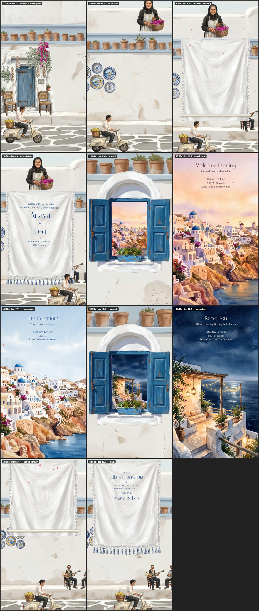

# wedding-invite-film

**A Claude skill that makes personalised, hand-painted wedding invitation videos — for any couple, any ceremonies, any place.**

Tell Claude the names, the ceremonies, the venue and the song. You get back a 9:16 invite film (WhatsApp / Instagram ready)
that moves in one continuous shot:

- the camera glides along a **hand-painted street** while a rickshaw, Vespa or carriage rides along with it
- an elder on the roof **unrolls a cloth banner** with your invitation, petals falling, each line writing itself on
- the camera **flies through an ornate window** into a painting of each ceremony — Mehendi by day, Sangeet by night,
  Haldi in a petal shower, the Pheras, the Nikah, a welcome evening, the reception…
- it pulls back out, moves on to the next window, and ends on a **venue banner** with your families' sign-off —
  all timed to the beat of your song

<p align="center">
  
  
  
  
</p>

▶ **Demo films** (silent previews; the skill renders with your song):
[Rajasthan — Mohini & Rishabh](examples/01-mohini-rishabh-rajasthan/demo-720p.mp4) ·
[Santorini — Anaya & Leo](examples/02-anaya-leo-santorini/demo-720p.mp4)

<p align="center">
</p>

## Make it yours
| | |
|---|---|
| **Names & words** | the couple, blessings, families' sign-off, any wording, any language (Devanagari, Gurmukhi, Tamil, Malayalam, Urdu, Japanese…) |
| **Ceremonies** | as many as you like, each with its own painting, day or night, petals (marigold, rose, jasmine, haldi, blossom…) or stars |
| **Your photos** | a painted, framed portrait of the couple on the street; the couple riding the scooter/rickshaw; your real venue repainted |
| **Music** | your song (any part of it — timing adapts and lands on the beat) or an original instrumental made with Atlabs |
| **The place** | 16 ready themes, or describe any other place |

**Places:** 🇮🇳 Rajasthan ★ · Udaipur · Kerala · Goa · Varanasi · Punjab · Chettinad · Mughal Agra/Lucknow —
🌍 Santorini ★ · Tuscany · Paris · Lake Como · Bali · Scotland · Kyoto · Marrakech
(★ ships with finished paintings — no credits needed for a text-only invite). Each place has its own street, window,
banner cloth, elder on the roof, vehicle, props, ceremony paintings, colours and fonts. [All themes →](skills/wedding-invite-film/references/themes.md)

## What you need
- **Claude Code** (or Claude Desktop / claude.ai with skills)
- **The Atlabs MCP** — required. Every painting is generated with Atlabs (**Nano Banana 2.1**, **GPT Image 2.5 Sunburst**
  for venue photos); a new place uses ≈ 13–15 credits. [How to connect →](docs/atlabs-mcp.md)
- **Node 18+**, **ffmpeg**, **Playwright** (Chromium), **Python 3.10+** with numpy/scipy/pillow/rembg

## Install
**As a plugin (Claude Code)** — the Atlabs MCP comes bundled:
```
/plugin marketplace add Chinmaya123-cyber/wedding-invite-film
/plugin install wedding-invite-film@wedding-invite-film
```
Then `/mcp` → **atlabs** → sign in.

**As a skill only:** copy `skills/wedding-invite-film` into `~/.claude/skills/` and connect Atlabs yourself
(`claude mcp add --transport http atlabs https://mcp.atlabs.ai/mcp`, then `/mcp` → atlabs → sign in).
Then `cd ~/.claude/skills/wedding-invite-film && npm install && npx playwright install chromium && python3 -m pip install -r requirements.txt`.

Full steps: [docs/installation.md](docs/installation.md)

## Use it
Just ask:

> Make a wedding invite video for Mohini and Rishabh in the Rajasthan style with our song `~/Music/ours.mp3` — Mehendi,
> Sangeet, Haldi and the Pheras on 14–15 February, at The Amber Haveli, Jaipur.

> We're getting married in Santorini — Anaya & Leo, welcome drinks, ceremony and reception. Make an invite like the Indian
> street ones but Greek island style, and paint us onto the Vespa (photos attached).

Claude asks a few quick questions, then: **scaffold → write the invitation → paint the missing scenes on Atlabs →
check sheets → render 1080×1920 → full-quality + share-size MP4.** Changing a date later is one edit and one render.
More: [docs/example-prompts.md](docs/example-prompts.md) · How it works: [docs/how-it-works.md](docs/how-it-works.md)

## What's inside
```
skills/wedding-invite-film/
  SKILL.md            the workflow Claude follows (Atlabs gate → brief → scaffold → words → paintings → render → deliver)
  template/           the film engine: plan.js (timing for any song), scenes.js (every frame from time), styles, fonts
  themes/             16 places + defaults (street, window, banner, roof figure, rider, props, paintings, colours, fonts)
  scripts/            new_invite · art_jobs (Atlabs prompts) · cutout (background removal + window opening) · sheet ·
                      tempo (BPM) · plan (timeline) · render (Playwright → ffmpeg)
  assets/             finished paintings for Rajasthan and Santorini, style anchors
  references/         atlabs-mcp · art · customise (invite.json) · themes (+ writing a new place) · from-a-reference
examples/             two complete invites: invite.json, frames, the paintings, silent demo films
docs/                 installation, Atlabs MCP, example prompts, how it works
```
The whole skill in one file: [wedding-invite-film-SKILL.md](wedding-invite-film-SKILL.md)

## Credits & notes
- Paintings and optional music spend Atlabs credits — Claude tells you the count before generating.
- Use your own music and make sure you may share it; the demos here are silent.
- Use photos of yourselves (or of people who agreed). Generated people are always invented locals.
- Example names, dates and venues are fictional.

MIT licence — see [LICENSE](LICENSE). Bundled fonts: OFL / Apache 2.0 (see `template/fonts/LICENSES.md`).
